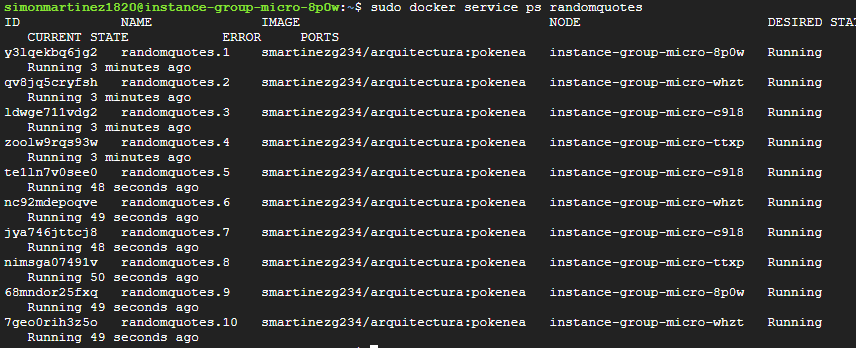
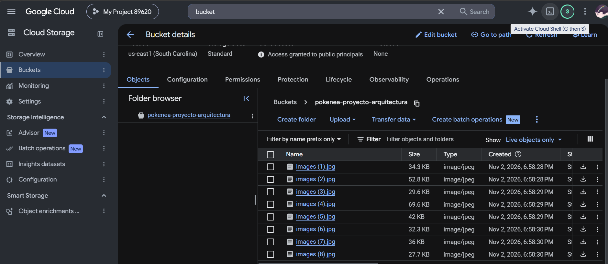

# Taller 02 – En parejas

**Participantes:**

- ________________________________
- ________________________________

> **Nota importante:** Quien no tenga acceso a GCP, adapte las instrucciones a AWS: en vez de buckets, S3 ...

> **Nota importante 2:** No tienen que autoescalar las instancias, es opcional.

---

## Proyecto Pokedex (en Express)

**Pokenea** (nacidos en Antioquia). Los Pokeneas tienen la siguiente información:

- Id
- Nombre
- Altura
- Habilidad
- Imagen
- Frase filosófica

### Requisitos

- Cree un sistema con 2 secciones (rutas):
  - **Ruta 1:** desplegará en un JSON el id, nombre, altura y habilidad de alguno de los Pokeneas (lo sacará de forma aleatoria del arreglo de Pokeneas; no necesitamos una BD, con que esté en un arreglo quemado basta). Sugerencia: inspírese en este sitio web: <https://www.pokemon.com/el/pokedex/>. Además, el JSON incluirá el **id del contenedor** desde el cual se está corriendo la aplicación.
  - **Ruta 2:** mostrará por pantalla la **imagen** y la **frase filosófica** de un Pokenea de manera aleatoria. Además, mostrará el **id del contenedor** desde el cual se está corriendo la aplicación.
- Las imágenes de los Pokeneas estarán almacenadas en **Buckets de GCP**.
- Cree entre **7 y 10 Pokeneas**.
- Mejore la arquitectura del proyecto para que no quede todo junto en un solo archivo.
- Suba el proyecto a **GitHub**.
- Cree un nuevo proyecto en **DockerHub** y conecte el proyecto de GitHub a este DockerHub (con **GitHub Actions**).

---

## Despliegue en GCP

> Si trabaja en parejas, cada uno deberá desplegarlo en su propia cuenta, y luego el docente escoge al azar la cuenta de uno de los 2 para probar y sustentar. **SOLO SUSTENTA UNO.** La sustentación demora 5 minutos.

1. Cree **4 instancias** en GCP con Docker (utilice un template como el definido en la "Presentación-13-B-Tutorial-microservicios-docker").
2. Una instancia será la **líder** (inicie Docker Swarm), y desde ahí obtenga el token para unirse como "manager".
3. Las otras 3 instancias se unirán al clúster de Docker Swarm como "managers".
4. Desde la líder, cree un nuevo servicio basado en la imagen de DockerHub del nuevo proyecto Pokeneas. Cree **10 réplicas** de ese servicio.

---

## Verificación

- Verifique que el servicio se ejecuta adecuadamente (verifique las 2 rutas) y que el **id del contenedor varía** entre los diferentes contenedores creados en las diferentes instancias de GCP.

---

## Pantallazos

### 1. Consola con las 10 réplicas (contenedores)

*(Pegue aquí el pantallazo)*

### 2. Lista de imágenes almacenadas en GCP

*(Pegue aquí el pantallazo)*

### 3. Dos pantallazos de la aplicación

Ruta donde se ven las imágenes, ejecutando con **2 ids de contenedor diferentes**.

*(Pegue aquí los pantallazos)*

---

## Acceso a la APP

| Integrante | IP para que el docente pueda probar |
|------------|-------------------------------------|
| Integrante 1 | _________________________ |
| Integrante 2 | _________________________ |